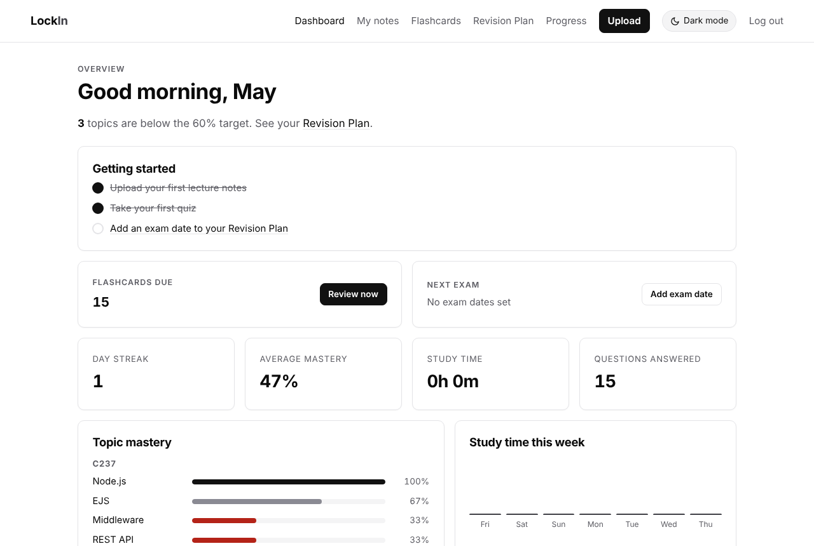
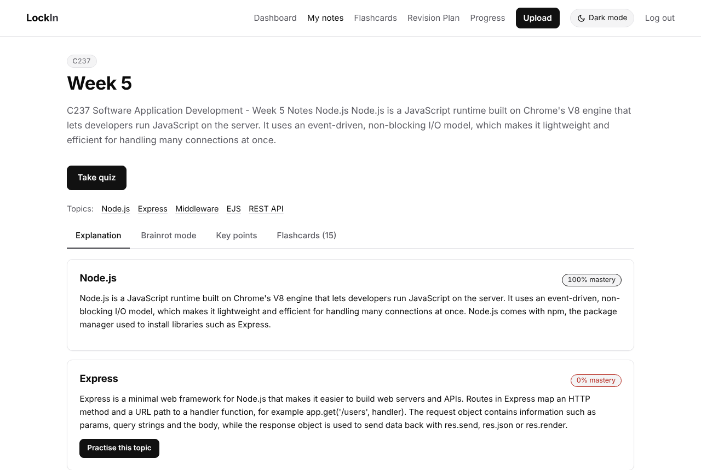
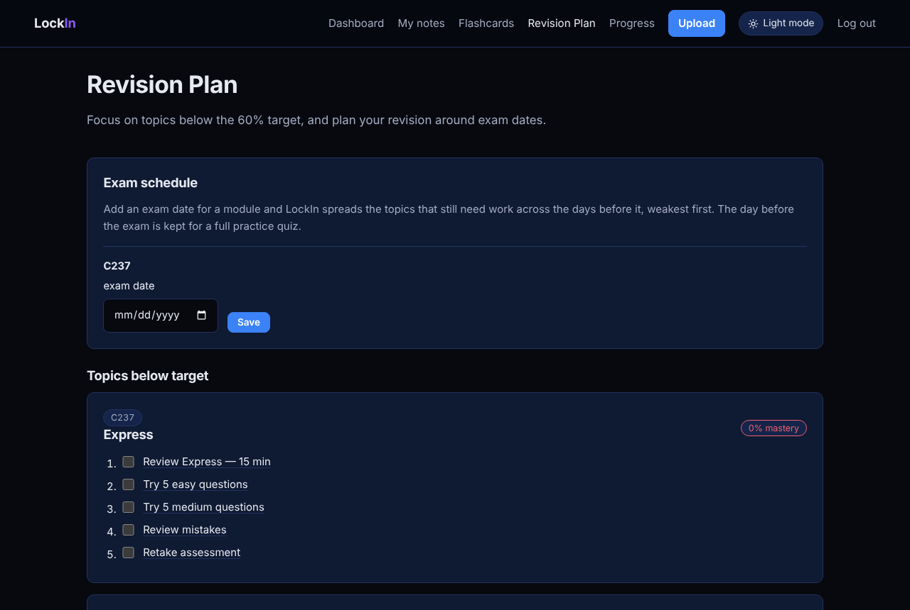
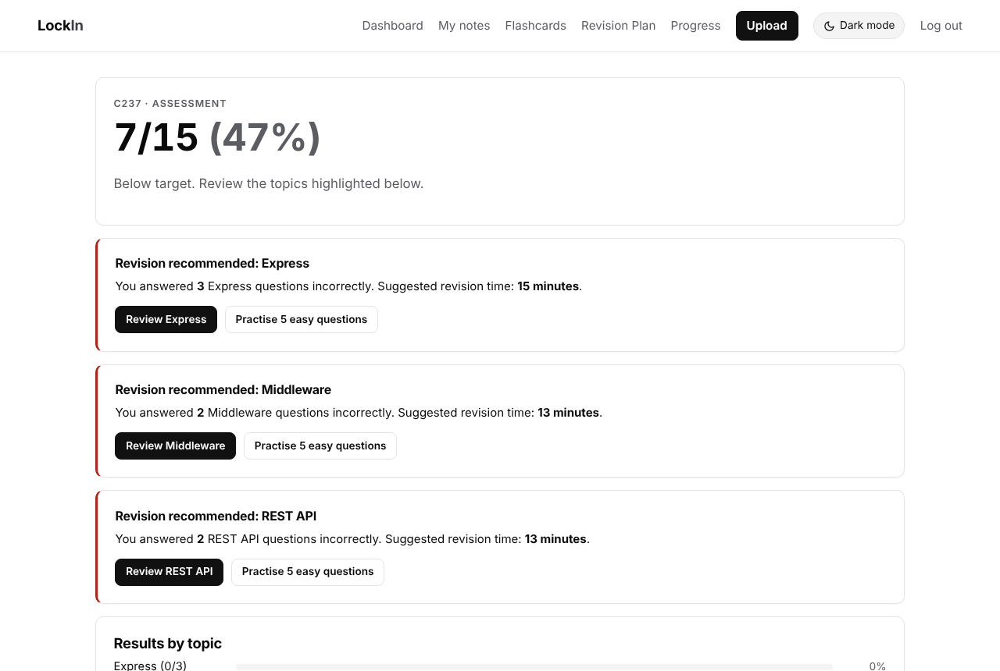
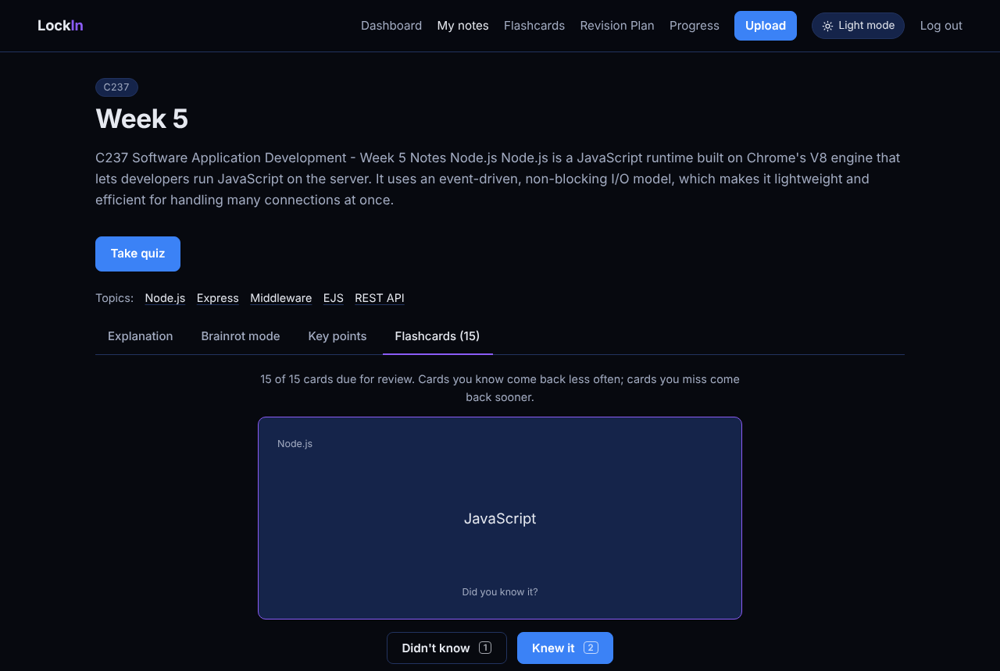

# LockIn

[](https://github.com/maypoe82/lockin/actions/workflows/ci.yml)

**Adaptive study platform for university students.**
Upload lecture notes and LockIn generates explanations, flashcards and quizzes, measures your understanding of each topic, and builds a revision plan around your weak topics and exam dates.

**Live demo:** https://lockin-vum5.onrender.com
(Free hosting: the first visit after a quiet period takes about 50 seconds to wake up.)



| Study page | Revision Plan (dark mode) |
|---|---|
|  |  |
| **Quiz results** | **Flashcards with spaced repetition** |
|  |  |

## Features

| | |
|---|---|
| **AI study packs** | A lecture PDF is split into topics, each with an explanation, a casual "Brainrot mode" explanation, key points, flashcards and quiz questions (easy, medium, hard) |
| **Background generation** | Uploads return immediately; a status page updates itself when the study pack is ready, with a retry option if the AI service is busy |
| **Topic mastery** | Each topic's score is based on the last 10 answers, so improvement shows quickly |
| **Revision alerts** | After a quiz: "You answered 3 Middleware questions incorrectly. Suggested revision time: 12 minutes" |
| **Revision Plan** | Topics below 60% get a five-step plan: review, easy questions, medium questions, review mistakes, retake |
| **Adaptive questions** | Practice quizzes use questions you have not yet answered correctly; when they run out, new ones are generated for that topic |
| **Exam planner** | Add an exam date per module; topics that need work are spread across the days before it, weakest first |
| **Spaced repetition** | Flashcards use the Leitner system: known cards return after 1, 3, 7, 14 then 30 days; missed cards return the same day |
| **Progress tracking** | Quiz score trend chart and first-vs-latest mastery for every topic; daily streak and study time |
| **Accounts** | Sign up, log in, password reset by email |
| **Light and dark mode** | Switchable, remembered per browser, defaults to the device setting |

## Tech stack

- **Backend:** Node.js, Express, EJS server-rendered views
- **Database:** MySQL 8 (TiDB Cloud in production)
- **AI:** Google Gemini with JSON-structured prompts, output validation, retries, model fallback and a time limit
- **Security:** bcrypt password hashing, CSRF tokens, Helmet security headers with a nonce-based Content Security Policy, rate limiting on login/upload/reset, session regeneration on login, database-backed sessions
- **DevOps:** Docker, Docker Compose, GitHub Actions CI (tests against a real MySQL service + Docker build), Render deployment, Jenkinsfile for a self-hosted pipeline

```
Browser ──► Express routes ──► services/ai.js ───────► Gemini
                │               services/analytics.js   (mastery, revision plan, streaks)
                │               services/spaced.js      (flashcard scheduling)
                │               services/schedule.js    (exam planner)
                ▼
              MySQL  (users, materials, topics, questions, answers, sessions, ...)
```

## Run locally

### With Docker

```bash
cp .env.example .env          # add your GEMINI_API_KEY
docker compose up --build
```

Open http://localhost:3000. On Windows you can double-click `start-lockin.bat`.

### Without Docker

Requires Node 18+ and MySQL.

```bash
npm install
cp .env.example .env          # set DB_* and GEMINI_API_KEY
npm run db:init               # creates or upgrades the tables
npm run dev
```

Without an AI key the app runs in demo mode, which builds topics and fill-in-the-blank questions from your headings.

## Tests

```bash
npm test
```

- **Unit tests:** mastery levels, revision time, weak topics, Revision Plan, spaced repetition intervals, exam scheduling, AI output validation
- **Integration test:** a full student journey over HTTP against a real database (sign up, upload, background generation, flashcard review, quiz, results, exam date, progress), plus CSRF and login-required checks

GitHub Actions runs all tests on every push, then builds the Docker image.

## Deployment (free tier)

| Part | Service |
|---|---|
| Web app | Render free web service (Docker), auto-deploys on every push to `main` |
| Database | TiDB Cloud Starter (MySQL-compatible), $0 spending limit |
| AI | Google Gemini API key |

Environment variables on Render: `DB_HOST`, `DB_PORT`, `DB_USER`, `DB_PASSWORD`, `DB_NAME`, `DB_SSL=true`, `GEMINI_API_KEY`, `SESSION_SECRET`, `NODE_ENV=production`, and optionally `SMTP_*` for password reset emails. Tables are created and upgraded automatically on startup.

## Project structure

```
app.js                 Express setup, security, sessions, error pages
config/                MySQL pool, database session store
db/                    schema.sql, migrate.js (auto-upgrade), init.js
middleware/            login check, security (CSP, CSRF, rate limits)
routes/                auth (incl. password reset), dashboard + plan, materials, quiz, study (flashcards, exams, progress)
services/              ai, analytics, spaced repetition, exam schedule, pdf, mail
views/                 EJS pages and partials
public/                CSS (light/dark themes) and front-end JS
tests/                 unit and integration tests
.github/workflows/     CI pipeline
```

## Resume summary

> **LockIn — AI-Powered Adaptive Learning Platform.** Built a full-stack learning platform (Node.js, Express, MySQL) that turns lecture notes into explanations, flashcards and quizzes using LLM prompt engineering, with background processing, retries and model fallback. Implemented per-topic mastery analytics, adaptive question generation, spaced-repetition flashcards and an exam-date revision planner. Secured with CSRF protection, CSP headers, rate limiting and database-backed sessions. Containerised with Docker, tested with unit and integration tests in a GitHub Actions CI pipeline, and deployed on Render with TiDB Cloud.
